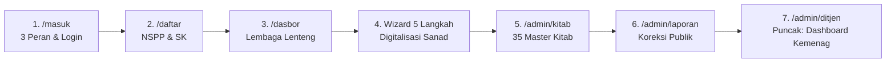

# 🎙️ Panduan Inti Demo Admin MOCHI (Cheatsheet Presenter)
### Khusus Presentasi Demo Fitur Administrasi, Tata Kelola & Dashboard Ditjen
**Lomba Santrivision 2026 — Ditjen Pendidikan Diniyah & Pondok Pesantren Kemenag RI**

---

> [!TIP]
> ### ⚡ ATURAN EMAS DI ATAS PANGGUNG (MAKSIMAL 3 MENIT)
> 1. **Jangan jelaskan fungsi teknis per tombol** — Juri tidak menilai tombol, juri menilai **solusi, dampak, dan kesiapan sistem**.
> 2. **Pola 3 Detik Tiap Layar:**
>    * 👉 **Tunjuk:** Arahkan kursor/laser ke fitur utama.
>    * 🎯 **Poin Inti:** Sebutkan 1 keunggulan terbesarnya.
>    * 📢 **Suara Panggung:** Ucapkan 1 kalimat mantap yang sudah disiapkan.
> 3. **Tampil tenang, santun khas santri, namun percaya diri secara teknologi.**

---

## 🏆 3 Pesan Emas yang Wajib Menancap di Pikiran Juri

1. **Bukan Sekadar Repositori Teks, Tapi Standarisasi Sanad Digital:** Setiap keputusan hukum terikat dewan mushohhih, teks Arab berharakat, dan rujukan kitab kuning yang jelas.
2. **Kedaulatan Pesantren Terjaga Penuh:** Platform multi-tenant dengan isolasi basis data (RLS). Kemenag maupun admin tidak bisa mengintervensi atau mengubah isi fatwa.
3. **Instrumen Kebijakan Pertama untuk Kemenag RI:** Dashboard Ditjen menyajikan agregat tren fatwa nasional dan tombol ekspor data kedinasan dalam hitungan detik.

---

## 🧭 Alur Navigasi Demo (7 Layar Berurutan)

---

## 1. Pembuka: Struktur 3 Peran Pengguna (20 Detik)

> 📢 **Suara Panggung (Ucapkan Lugas):**  
> *"Bapak/Ibu Dewan Juri, MOCHI menjamin integritas hukum Islam dengan membagi hak akses ke dalam **3 peran resmi yang terisolasi ketat**, tanpa celah intervensi:"*

* 🔴 **Pengunjung Publik:** Bebas membaca, menguji fatwa, bertanya ke AI, dan mengirimkan koreksi teks Arab.
* 🟢 **Lembaga Pesantren / LBM NU (`lenteng@mochi.pesantren.id`):** Ruang kerja mandiri untuk mendokumentasikan dan menerbitkan keputusan bahtsul masail milik lembaganya sendiri.
* 🔵 **Admin Pusat Kemenag (`admin@mochi.pesantren.id`):** Mengelola legalitas lembaga, memoderasi koreksi publik, dan memantau intelijen data nasional.
* ⚪ *(Catatan: Peran developer sengaja **ditiadakan dari UI** agar fatwa bebas dari pintu belakang/backdoor).*

---

## 2. Pintu Masuk & Pendaftaran Selektif (`/masuk` & `/daftar`)

*Layar 1: Pintu Masuk Cerdas dengan Proteksi Brute-Force*

* 👉 **Yang Ditunjuk di Layar:** Kotak form login dan tautan pendaftaran lembaga.
* 🎯 **POIN INTI YANG DISAMPAIKAN:**
  * **Satu Pintu Otomatis:** Sistem mengenali peran dan langsung mengarahkan Admin ke `/admin` atau Pesantren ke `/dasbor`.
  * **Pencegahan Peretasan:** Dilengkapi *rate limiter* (maksimal 5x salah sandi per menit).
* 📢 **Suara Panggung:**  
  *"Portal masuk ini dilengkapi perlindungan brute-force dan secara cerdas langsung mengarahkan pengguna ke ruang kerjanya masing-masing."*

---

*Layar 2: Pendaftaran Pesantren Wajib NSPP 12 Digit Kemenag*

* 👉 **Yang Ditunjuk di Layar:** Toggle pilihan "Pesantren / LBM", kolom input NSPP, dan unggah SK/Piagam.
* 🎯 **POIN INTI YANG DISAMPAIKAN:**
  * **Gerbang Selektif:** Hanya lembaga resmi yang boleh mendaftar — Pesantren wajib **12 Digit NSPP Kemenag**, struktur NU wajib **SK Kepengurusan**.
  * **Prinsip Kehati-hatian (Ihtiyath):** Verifikasi dua tahap: validasi format instan di sistem, disusul verifikasi berkas oleh Kemenag.
* 📢 **Suara Panggung:**  
  *"Untuk menjaga marwah fatwa, MOCHI menyaring pendaftar secara ketat: pesantren divalidasi dengan 12 digit NSPP resmi Kemenag, dan LBM NU diverifikasi melalui SK kepengurusan sah."*
* 🛡️ **Pagar Pengaman Juri (Jika ditanya koneksi langsung ke EMIS):**  
  > *"Kami sengaja memadukan validasi format otomatis dengan peninjauan SK otentik demi prinsip ihtiyath (kehati-hatian). Struktur database MOCHI sudah siap 100% dihubungkan ke API EMIS begitu izin integrasi kedinasan dibuka."*

---

## 3. Dasbor Kerja Lembaga Lenteng (`/dasbor`)

*Layar 3: Dasbor LBM MWCNU Lenteng Terverifikasi*

* 👉 **Yang Ditunjuk di Layar:** 
  1. Lencana hijau **"Terverifikasi"** di header.
  2. Kartu statistik & tabel daftar forum.
  3. Bagian **"Catatan Koreksi & Uji Publik Masail"** di bagian bawah.
* 🎯 **POIN INTI YANG DISAMPAIKAN:**
  * **Kedaulatan & Kerahasiaan (Multi-Tenant RLS):** LBM Lenteng memiliki ruang kerja privat. Draf musyawarah Lenteng tidak bisa diintip oleh Lirboyo, Tebuireng, maupun publik.
  * **Umpan Balik Terbuka:** Catatan koreksi dari santri/pembaca masuk langsung ke dasbor lembaga lengkap dengan tombol pintas ke editor.
* 📢 **Suara Panggung:**  
  *"Di dasbor LBM Lenteng ini, data terisolasi secara kriptografis melalui Row-Level Security database. Di sini pesantren mengelola keputusan hukumnya secara mandiri, sekaligus menerima catatan koreksi naskah langsung dari pembaca."*

---

## 4. Jantung Produk: Wizard 5 Langkah Digitalisasi Sanad (`/dasbor/forum/baru`)

*Layar 4: Wizard 5 Langkah Menstandardisasi Hasil Bahtsul Masail*

> [!IMPORTANT]
> **BERIKAN PENEKANAN TERTINGGI DI SINI (45 DETIK) — INILAH NILAI INOVASI UTAMA MOCHI.**

* 👉 **Yang Ditunjuk di Layar:** Bar progres 5 langkah di bagian atas dan kolom nama Mushohhih.
* 🎯 **POIN INTI YANG DISAMPAIKAN (Sebut Cepat 5 Langkahnya):**
  1. **Langkah 1 (Sanad Tokoh):** Konversi tanggal otomatis Masehi-Hijriah, pencatatan dewan Mushohhih, Perumus, dan Moderator.
  2. **Langkah 2 (Rincian Kasus):** Penetapan topik wajib (*Ibadah, Muamalah, Munakahat*) dan corak fikih.
  3. **Langkah 3 (Diktum Hukum):** Pertanyaan deskriptif dan jawaban hukum yang tegas.
  4. **Langkah 4 (Ibarat Kitab Kuning):** Terhubung ke Master Kitab Turats, editor teks Arab berfont Amiri RTL, lengkap dengan harakat, juz, dan nomor halaman.
  5. **Langkah 5 (Tashih & Terbit):** Status hanya dua: `draf` (tertutup) atau `terbit` (publik).
* 📢 **Suara Panggung:**  
  *"Inilah jantung inovasi MOCHI: Wizard 5 Langkah yang mentransformasi notulensi kertas fotokopi menjadi arsip digital bersanad lengkap. Keputusan hukum wajib mencantumkan dewan mushohhih yang mengesahkan, diktum hukum yang tegas, serta ibarat rujukan kitab kuning dengan harakat asli."*

---

## 5. Repositori Master Kitab Turats (`/admin/kitab`)

*Layar 5: 35 Master Kitab Turats Muktabarah yang Sudah Terindeks*

* 👉 **Yang Ditunjuk di Layar:** Tabel katalog kitab (Fathul Wahhab, Al-Majmu', Bughyah al-Mustarsyidin, dll.).
* 🎯 **POIN INTI YANG DISAMPAIKAN:**
  * **35 Kitab Muktabarah Terstandarisasi:** Menjamin tidak ada pengarang atau judul kitab fiktif saat pesantren memasukkan dalil.
  * **Roadmap Fase 2 (Pencarian Silang):** Saat ini fokus 100% pada hasil bahtsul masail; fase berikutnya repositori ini siap menjadi katalog *cross-reference* untuk mencari fatwa-fatwa di seluruh Indonesia yang memakai ibarat dari kitab yang sama.
* 📢 **Suara Panggung:**  
  *"Kami telah menanamkan 35 Master Kitab Turats rujukan utama di database. Fokus kami saat ini adalah mengamankan produk fatwanya, dan ke depan modul ini siap dikembangkan menjadi repositori pencarian silang dalil antar-pesantren se-Indonesia."*

---

## 6. Moderasi Laporan Koreksi Publik (`/admin/laporan`)

*Layar 6: Meja Moderasi Laporan Koreksi Teks Arab & Data Masail*

* 👉 **Yang Ditunjuk di Layar:** Tab filter status (*Baru, Diproses, Selesai*) dan kartu rincian laporan masyarakat.
* 🎯 **POIN INTI YANG DISAMPAIKAN:**
  * **Peer-Review Umat (Uji Publik Ijtima'i):** Publik yang menemukan salah harakat atau typo pada teks Arab dapat melapor lewat tombol khusus di naskah fatwa.
  * **Filter Admin Kemenag:** Laporan difilter dari spam, kemudian Admin Pusat meneruskan catatan perbaikan tersebut ke dasbor pesantren terkait.
* 📢 **Suara Panggung:**  
  *"Untuk menjaga kesucian jutaan huruf Arab kitab kuning, MOCHI membuka uji publik ijtima'i. Santri dan akademisi dapat melaporkan koreksi harakat, dan Admin Kemenag memoderasinya secara transparan sebelum diteruskan ke pesantren terkait."*

---

## 7. Puncak Demo: Dashboard Nasional Ditjen Pesantren (`/admin/ditjen`)

*Layar 7: Dashboard Intelijen & Pemetaan Fatwa Nasional Kemenag RI*

> [!IMPORTANT]
> **TUTUP DEMO ANDA DI SINI — INILAH VALUE TERTINGGI BAGI KEMENTERIAN AGAMA RI.**

* 👉 **Yang Ditunjuk di Layar:**
  1. Kartu metrik agregat nasional (Total tayangan pembaca, total forum, total keputusan terbit).
  2. Grafik perbandingan topik (*Ibadah vs Muamalah vs Munakahat*).
  3. Peta sebaran provinsi dan tombol **"Ekspor CSV Kedinasan"**.
* 🎯 **POIN INTI YANG DISAMPAIKAN:**
  * **Instrumen Pembuat Kebijakan (Policy-Making Tool):** Kemenag dapat membaca arah dinamika hukum masyarakat santri secara *real-time* (misalnya: naiknya pembahasan ekonomi syariah / pinjol di Jawa Timur).
  * **Satu Klik Laporan Kedinasan:** Data siap diunduh dalam format CSV resmi untuk kebutuhan laporan dinas dan arsip negara.
* 📢 **Suara Panggung (Penutup Mantap):**  
  *"Inilah kontribusi terbesar MOCHI untuk Kementerian Agama RI: Dashboard Nasional Ditjen Pesantren. Untuk pertama kalinya, Kemenag memiliki radar dinamika fatwa umat berbasis data riil, pemetaan keaktifan pesantren per daerah, serta instrumen ekspor data kedinasan dalam satu klik. Terima kasih."*

---

## ⏱️ Skrip Contek Cepat 3 Menit (Cue Card Panggung)

| Detik | Layar | Yang Ditunjuk | Kalimat Inti di Panggung |
|---|---|---|---|
| **00 - 25** | `/masuk` & `/daftar` | Form login & input 12 digit NSPP | *"MOCHI memisahkan peran Pengunjung, Pesantren, dan Kemenag dengan registrasi ketat berbasis 12 digit NSPP dan SK resmi."* |
| **25 - 50** | `/dasbor` | Lencana verifikasi & kartu statistik | *"Di dasbor Lembaga Lenteng ini, data terisolasi aman dengan Row-Level Security, menjamin kerahasiaan draf fatwa antar-pesantren."* |
| **50 - 95** | `/dasbor/forum/baru` | Step 1 (Tokoh) & Step 4 (Ibarat Arab) | *"Wizard 5 Langkah mendigitalkan sanad fatwa: mencatat dewan mushohhih, teks Arab berharakat, dan rujukan 35 master kitab turats."* |
| **95 - 120** | `/admin/kitab` & `/admin/laporan` | Daftar kitab & kartu laporan koreksi | *"Admin mengelola 35 master kitab turats standar serta memoderasi koreksi teks Arab dari publik secara transparan."* |
| **120 - 180** | `/admin/ditjen` | Grafik topik, peta sebaran, tombol CSV | *"Puncaknya, Dashboard Ditjen Pesantren memberi Kemenag pemetaan fatwa nasional dan instrumen ekspor laporan resmi kedinasan."* |

---

## 🥊 5 Pertanyaan Jebakan Juri & Jawaban Taktis (1 Kalimat)

1. **Juri: *"Apakah draf rahasia Pesantren A bisa dibaca Pesantren B?"***  
   👉 **Jawaban:** *"Tidak bisa, karena arsitektur database kami menerapkan Row-Level Security yang mengunci data langsung di tingkat query PostgreSQL, bukan sekadar di tampilan antarmuka."*

2. **Juri: *"Apakah verifikasi NSPP sudah online ke database EMIS Kemenag?"***  
   👉 **Jawaban:** *"Untuk tahap ini kami menerapkan validasi 12 digit numerik dan kurasi SK manual demi kehati-hatian (*ihtiyath*) fatwa; skema sistem kami sudah siap terhubung ke API EMIS secara instan (*plug-and-play*) begitu izin integrasi dibuka."*

3. **Juri: *"Apakah Kemenag atau Admin bisa mengedit hasil fatwa yang dibuat pesantren?"***  
   👉 **Jawaban:** *"Sama sekali tidak. Kedaulatan hukum ada penuh pada Dewan Mushohhih pesantren; peran Admin Pusat murni memverifikasi legalitas lembaga dan memoderasi laporan sanggahan publik."*

4. **Juri: *"Mengapa fokus ke bahtsul masail dulu, bukan repositori kitab digital lengkap?"***  
   👉 **Jawaban:** *"Karena urgensi utama pesantren saat ini adalah menyelamatkan ribuan arsip fatwa yang tercecer di kertas fotokopi; 35 master kitab turats yang kami sediakan berfungsi sebagai jangkar sanad, dan modulnya siap kami kembangkan menjadi katalog silang dalil di fase 2."*

5. **Juri: *"Bagaimana mencegah spam atau manipulasi di fitur koreksi publik?"***  
   👉 **Jawaban:** *"Kami memasang IP-based rate limiter maksimal 5 laporan per 10 menit dengan validasi Zod, dan setiap laporan disaring terlebih dahulu di meja moderasi Admin Pusat sebelum diteruskan ke pesantren terkait."*

---

*Panduan ini disusun untuk performa terbaik di babak final. Hafalkan poin intinya, pegang kendali panggung, dan semoga juara! 🚀*
