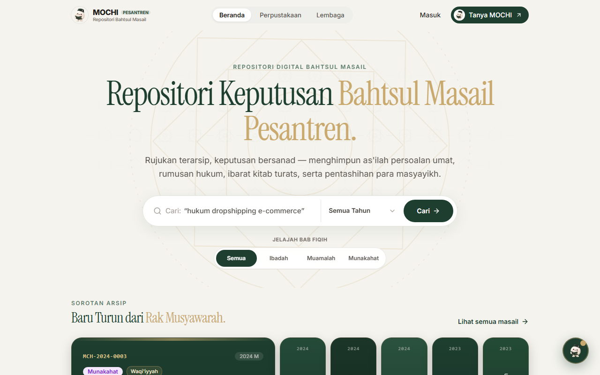
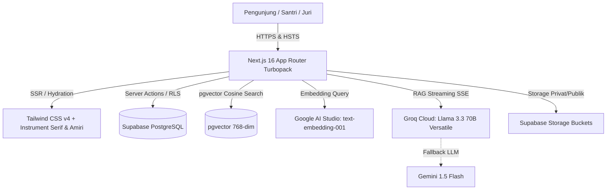

# MOCHI — Masail Online & Comprehensive Heritage Intelligence

## Repositori Digital Keputusan Bahtsul Masail Pesantren Nusantara

> *"Jawaban hukum Islam, dari musyawarah ulama bersanad."*

**MOCHI** adalah repositori digital modern yang menghimpun keputusan forum **bahtsul masail** pesantren se-Nusantara (tradisi Nahdlatul Ulama) secara terstruktur. Lembaga pesantren menerbitkan hasil kajian secara transparan lengkap dengan as'ilah (pertanyaan), diktum keputusan hukum, al-ma'khadz (ibarat kitab kuning turats Arab berharakat), serta dewan mushohhih dan perumus.

Publik dapat mencari, menelusuri khazanah fiqih, membandingkan perbedaan pandangan antar-forum (*khilafiyah*), dan bertanya secara interaktif melalui chatbot cerdas **"Tanya MOCHI"** yang dilengkapi **Zero-Hallucination Guard** (hanya menjawab dari repositori data tersimpan dengan sitasi terverifikasi).

Karya untuk **Lomba Santrivision 2026** (Direktorat Pendidikan Diniyah dan Pondok Pesantren, Kementerian Agama Republik Indonesia).  
**Kategori 03: Inovasi Digital & Teknologi Pesantren.**

---

### 🖥️ Pratinjau Antarmuka Beranda Utama MOCHI
<p align="center">
  
</p>

---

## 🏗️ Arsitektur Teknologi



| Lapisan | Pilihan Teknologi | Keterangan |
|---|---|---|
| **Framework** | Next.js 16.4.3 (App Router Turbopack) + TypeScript strict | Server Components, Server Actions, Middleware Proxy, Edge Cache, Soft SPA Navigation |
| **Styling & UI** | Tailwind CSS v4 + Instrument Serif + Amiri Naskh | Kanvas Ivory `#F4F3EE`, Forest Green `#1E3F30`, Gold `#C9A96E`, Viewport-Sticky Sidebars |
| **Micro-Interactions** | ReactBits (*FuseButton, SwipeToast, ThoughtLine, AccordionGallery*) | Undoing window, live latency indicator, dynamic spine gallery |
| **Basis Data** | PostgreSQL via Supabase + Row-Level Security | `pgvector` (768 dim), `pg_trgm`, `unaccent`, `pgcrypto` |
| **Autentikasi & Media** | Supabase Auth + Supabase Storage | 3 Buckets: `logo`, `dokumentasi`, `bukti-lembaga` (privat) |
| **Kecerdasan Buatan (AI)** | Google text-embedding-004 (768) + Groq Llama 3.3 70B RAG | Streaming SSE + Ambang Nol Halusinasi (0.60) + Gemini Flash Fallback + Tab Session Persistence |
| **Validasi & Keamanan** | Zod v3 + In-memory Rate Limiter + Security Headers | Validasi unggahan anti-malware, sanitasi XSS |
| **Pengujian** | Vitest 5 (90 unit tests, 13 test files) + Playwright (Produksi & Mobile 360px) | 100% kelulusan otomatis, audit keamanan & aksesibilitas WCAG AA |

---

## 🚀 Panduan Memulai Cepat (Local Development)

### 1. Prasyarat Sistem
- **Node.js** versi 20+ LTS
- **npm** versi 10+
- Akun **Supabase** (tier gratis didukung)
- Kunci API **Google AI Studio** dan **Groq Cloud**

### 2. Instalasi Dependensi
```bash
git clone <url-repo-privat>
cd mochi
npm install
```

### 3. Konfigurasi Lingkungan (`.env.local`)
Salin file template `.env.example`:
```bash
cp .env.example .env.local
```
Lengkapi nilai kunci:
- `NEXT_PUBLIC_SUPABASE_URL` dan `NEXT_PUBLIC_SUPABASE_ANON_KEY`
- `SUPABASE_SERVICE_ROLE_KEY` (kunci server rahasia)
- `GOOGLE_AI_API_KEY` (Google AI Studio)
- `GROQ_API_KEY` (Groq Console)
- `SESI_SALT` (string acak minimal 32 karakter)

### 4. Eksekusi Skema Basis Data & Inisialisasi Data Demo
1. Buka Supabase SQL Editor, jalankan isi file `supabase/schema.sql`.
2. Masukkan 20 masalah fiqih bersanad awal:
   ```bash
   npm run db:seed
   ```
3. Validasi integritas data:
   ```bash
   npm run db:validate
   ```
4. Buat vektor embedding awal:
   ```bash
   npm run embed
   ```

### 5. Jalankan Server Pengembangan
```bash
npm run dev
```
Buka peramban di `http://localhost:3000`.

---

## 📜 Perintah Skrip Tersedia

| Perintah | Deskripsi |
|---|---|
| `npm run dev` | Menjalankan server pengembangan lokal Next.js dengan Turbopack |
| `npm run build` | Menjalankan kompilasi produksi Next.js 16 (`next build`) |
| `npm run start` | Menjalankan server aplikasi siap produksi |
| `npm run lint` | Memeriksa kepatuhan kode via ESLint flat config (`--max-warnings 0`) |
| `npm run typecheck` | Memeriksa kepatuhan tipe TypeScript (`tsc --noEmit`) |
| `npm run test` | Menjalankan 90 pengujian unit otomatis via Vitest (13 test files) |
| `npm run test:e2e` | Menjalankan pengujian integrasi E2E Produksi & Mobile via Playwright Chromium |
| `npm run db:seed` | Mengimpor data demo 20 masalah fiqih bersanad (idempoten) |
| `npm run db:validate` | Memvalidasi integritas relasi tabel data keputusan |
| `npm run db:reset` | Mengosongkan data transaksi untuk pengujian ulang |
| `npm run db:backup` | Mencadangkan 8 tabel Supabase live ke format JSON timestamped |
| `npm run embed` | Membangun ulang vektor embedding 768 dimensi via Google AI |

---

## 🔑 Kredensial Pengujian Produksi (Multi-Role RBAC)

Sistem beroperasi dalam mode **100% Produksi Penuh**. Seluruh tombol jalan pintas demo instan ditiadakan untuk menjaga integritas keamanan repositori fiqih bersanad. Masuk dilakukan secara manual pada halaman [`/masuk`](file:///d:/LOMBA2/SANTRIVISION/app/(auth)/masuk/page.tsx) dengan perlindungan toggle mata (*default hidden*):

1. **Admin Pusat MOCHI / Ditjen Kemenag**: `admin@mochi.pesantren.id` / Sandi: `MochiAdmin2026!`
   - *Akses:* Verifikasi NSPP di `/admin/verifikasi`, audit laporan di `/admin/laporan`, master kitab di `/admin/kitab`, Dashboard Integrasi Nasional Ditjen (Peta Kepulauan Nusantara SVG & Diagram Donat Fiqih) di `/admin/ditjen`, dan Konsol Pemantauan Sistem & Telemetri Pengembang (SRE Cockpit) di `/admin/pemantauan`.
2. **Pengelola PP Lirboyo Kediri**: `lirboyo@mochi.pesantren.id` / Sandi: `Lirboyo1910!`
   - *Akses:* Dasbor pesantren terverifikasi, pembuatan forum masail baru via Wizard 5 Langkah di `/dasbor/forum/baru`, penarikan draf, dan statistik pembacaan di `/dasbor/statistik`.
3. **Pengelola PP Tebuireng Jombang**: `tebuireng@mochi.pesantren.id` / Sandi: `Tebuireng1899!`
   - *Akses:* Kelola keputusan hukum bersanad, publikasi fatwa, dan edit profil.
4. **Pengelola PP Sidogiri Pasuruan (Menunggu Verifikasi)**: `sidogiri@mochi.pesantren.id` / Sandi: `Sidogiri1745!`
   - *Akses:* Tampilan lembaga baru yang menunggu verifikasi legalitas NSPP oleh admin.

---

## 🛡️ Jaminan Keamanan & Kepatuhan Lomba

- **Row-Level Security (RLS)**: Aktif 100% di semua 14 tabel basis data PostgreSQL.
- **Pemisahan Kunci Ketat**: Kunci `SUPABASE_SERVICE_ROLE_KEY`, `GOOGLE_AI_API_KEY`, dan `GROQ_API_KEY` hanya berjalan di server (terisolasi dari bundel klien).
- **Sanitasi Masukan & Berkas**: Divalidasi via skema Zod, validator anti-malware berkas (`lib/validation/upload.ts`), dan bebas dari `dangerouslySetInnerHTML`.
- **Zero Hallucination Chatbot**: Kueri dengan skor relevansi kemiripan < 0.60 langsung ditolak tanpa memanggil LLM untuk menjaga kesucian fatwa fiqih.
- **Kepatuhan Lisensi**: Seluruh pustaka menggunakan lisensi permisif (MIT, Apache-2.0, ISC, SIL OFL 1.1) terdokumentasi di `THIRD_PARTY.md`.

---

## 📚 Indeks Dokumentasi Teknis

- [`docs/04_PROPOSAL_DAN_VIDEO.md`](docs/04_PROPOSAL_DAN_VIDEO.md) — Master Playbook Pitching, Naskah Video 2:45 Menit & Q&A Defense
- [`docs/QA_AUDIT_REPORT.md`](docs/QA_AUDIT_REPORT.md) — Laporan Resmi QA & Cyber Security Audit (Desktop & Mobile 360px)
- [`docs/01_PRD_MOCHI.md`](docs/01_PRD_MOCHI.md) — Dokumen Kebutuhan Produk & Fungsionalitas
- [`docs/02_SPESIFIKASI_TEKNIS.md`](docs/02_SPESIFIKASI_TEKNIS.md) — Arsitektur Teknis, Skema SQL & Relasi
- [`docs/DESIGN.md`](docs/DESIGN.md) — Sistem Desain MOCHI (Warna, Tipografi, Komponen)
- [`docs/KEAMANAN.md`](docs/KEAMANAN.md) — Checklist Keamanan & Hasil Audit Nyata
- [`docs/ARSITEKTUR_KEAMANAN.md`](docs/ARSITEKTUR_KEAMANAN.md) — Arsitektur Keamanan Berlapis & RLS
- [`docs/STATUS_FITUR.md`](docs/STATUS_FITUR.md) — Status Kesiapan Fitur Repositori (Versi 2.0)
- [`docs/AKUN_DEMO.md`](docs/AKUN_DEMO.md) — Panduan Kredensial Uji Sistem Produksi
- [`docs/EVAL_CHATBOT.md`](docs/EVAL_CHATBOT.md) — Laporan Uji Evaluasi Chatbot (22 Kasus)
- [`docs/UJI_KEGUNAAN.md`](docs/UJI_KEGUNAAN.md) — Laporan Uji Aksesibilitas WCAG AA & Skor SUS (88.5)
- [`docs/PEMULIHAN.md`](docs/PEMULIHAN.md) — SOP Pencadangan & Pemulihan Bencana
- [`docs/DEPLOY.md`](docs/DEPLOY.md) — Panduan Penerapan Vercel & Supabase
- [`docs/AI_USAGE_LOG.md`](docs/AI_USAGE_LOG.md) — Log Transparansi Penggunaan AI (Sesi 1 s.d. 27)

---

*MOCHI — Agar mutiara keilmuan bahtsul masail pesantren Nusantara tak berhenti sebagai tumpukan kertas arsip, melainkan menjadi panduan hukum peradaban digital.*
